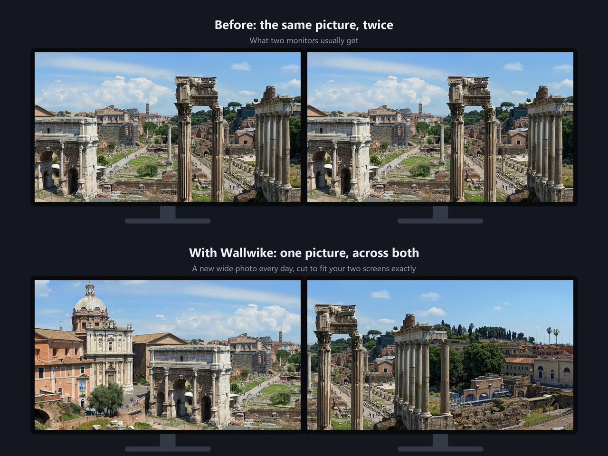
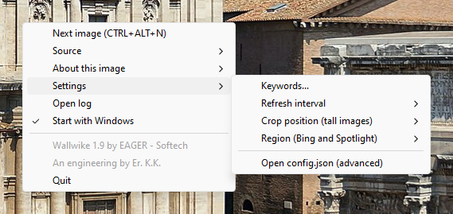
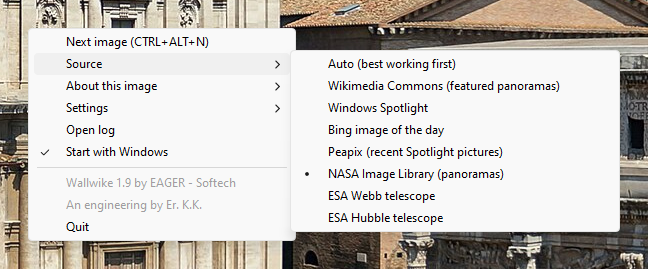
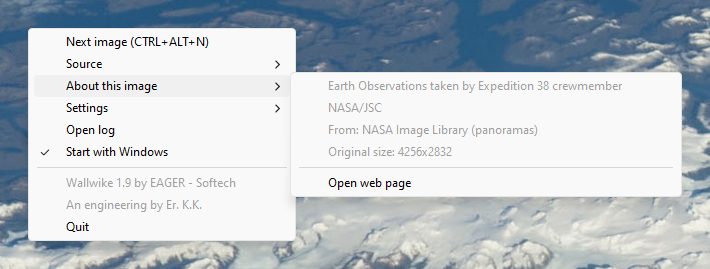
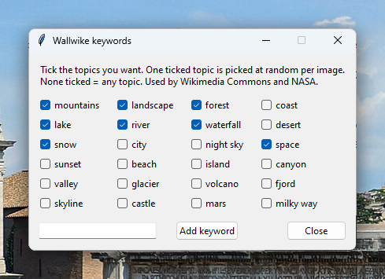

# Wallwike

**Two monitors, one wallpaper.** Windows puts the same picture on each screen. Wallwike finds a
wide photo, cuts it to fit both screens exactly and stretches it across them as a single view,
then swaps it for a new one every day. Or every 15 minutes, if you get bored easily.

*Wallwike by EAGER - Softech · An engineering by Er. K.K.*

## Why you might like it

- 🖼️ **One picture across both screens.** Left half on the left monitor, right half on the right,
  lined up to the pixel. No black bars, no stretching, no picture repeated twice.
- 🌄 **Photos worth looking at.** Featured panoramas from Wikimedia Commons, the Windows
  Spotlight pictures you know from the lock screen, the Bing picture of the day, and deep space
  from NASA and the Webb and Hubble telescopes.
- 🎯 **You choose the mood.** Tick any of 24 topics, from *mountains* and *waterfall* to
  *fjord*, *castle* and *mars*, or type your own word, and Wallwike picks from those.
- ⏱️ **As fresh as you want.** A new picture once a day, or every 12, 6, 3 or 1 hours, or every
  30 or 15 minutes.
- ⌨️ **Don't like today's?** Press **Ctrl+Alt+N** from anywhere and it's gone.
- 🔎 **"Where is that?"** *About this image* tells you right in the menu: what it is, who took
  it and where it came from. One more click opens the photo's own page.
- 🪶 **Stays out of the way.** One small icon near the clock. No window, no account, no ads,
  nothing to install.

## Download

Get **`Wallwike.exe`** from the [latest release](https://github.com/kirupakaran-k/Wallwike/releases/latest)
and run it. A tray icon (two small screens) appears near the clock and your first wallpaper
is set a few seconds later. Windows 10 or 11.

The app isn't code-signed, so the first time Windows SmartScreen may say *"Windows protected
your PC"*: click **More info → Run anyway**.

## Everything is on the right-click menu

Right-click the tray icon. That menu is the whole app.

| Menu item | What it does |
|---|---|
| **Next image** | A different picture, now. Same as Ctrl+Alt+N. |
| **Source** | *Auto* works down the list below until one delivers, or pick a favourite |
| **About this image** | The picture's name, credit, source and size, and a link to its web page |
| **Settings** | Keywords, how often to change, which part of tall pictures to keep, Bing region |
| **Open log** | What Wallwike has been up to, if something looks wrong |
| **Start with Windows** | Tick it once and Wallwike is there after every restart |

Left-clicking the icon does nothing, on purpose, so a stray click never costs you a picture
you liked.

### Where the pictures come from

The **Source** menu lists them best working first, and *Auto* tries them in that order:

| | Source | What you get |
|---|---|---|
| 1 | **Wikimedia Commons** | Featured panoramas, the only truly wide pictures here. Follows your keywords. |
| 2 | **Windows Spotlight** | The lock-screen photos from Windows 11, in 4K. Different ones every time. |
| 3 | **Bing image of the day** | One 4K photo a day, plus the last week's. |
| 4 | **Peapix** | The most recent Spotlight pictures from a second place, in case Microsoft's changes. |
| 5 | **NASA Image Library** | Panoramas from Mars, orbit and beyond. Follows your keywords where it can. |
| 6 | **ESA Webb telescope** | The newest Webb pictures. |
| 7 | **ESA Hubble telescope** | The newest Hubble pictures. |

Pick one and Wallwike uses it first, falling back down the list if it has nothing new. Only
Wikimedia's pictures are as wide as two screens; the others are ordinary wide photos, so the top
and bottom are trimmed to fit (**Settings → Crop position** chooses which part stays). Telescope
pictures are often square or tall, so expect a slice of them.

### What am I looking at?

**About this image** opens a small list with the picture's name, who it belongs to, which
source it came from and how big the original was. **Open web page** takes you to the full story.

### Pick your topics

**Settings → Keywords** opens a small window that stays open while you tick. One ticked topic is
picked at random for each new picture; tick none for anything goes.

## Good to know

- **Offline?** Wallwike keeps the picture you have and tries again every minute until it's back.
- **A site is blocked on your network?** If one source can't be reached while another works,
  Wallwike tries it last for the next 6 hours instead of making every change wait for it.
- **Built a newer version or moved the folder?** *Start with Windows* follows the copy you ran
  last.
- **Odd screen sizes?** Wallwike asks Windows for the combined size of your desktop (3840x1080
  for two 1920x1080 screens) and makes the picture exactly that big.
- Your settings, the log and the current wallpaper live in `%APPDATA%\Wallwike`, shared by every
  version.

## For tinkerers

The menu covers the everyday settings. The rest are in `config.json` (**Settings → Open
config.json**):

| Key | Meaning |
|---|---|
| `source` | `auto`, `wikimedia`, `spotlight`, `bing`, `peapix`, `nasa`, `webb` or `hubble` |
| `keywords` | list of topics, e.g. `["mountains", "space"]` |
| `hotkey` | e.g. `ctrl+alt+n`; `""` turns it off (restart the app after changing) |
| `refresh_minutes` | `0` = once a day; otherwise minutes between changes |
| `canvas` | `null` = detect the combined desktop size; or force one, e.g. `[3840, 1080]` |
| `vertical_anchor` | which part to keep when cropping tall pictures: 0 = top, 0.5 = middle, 1 = bottom |
| `bing_market` | Region for Bing and Spotlight, e.g. `en-IN` |

### Run it from source

Needs Python 3.10 or newer.

1. Double-click `install.bat`. It installs Pillow and pystray, then checks which picture sources
   your network can reach.
2. Double-click `run.bat`. The tray icon appears and today's wallpaper is set.

`python wallwike.py --test` shows which sources work, and `python wallwike.py --once` sets a
wallpaper without the tray app.

### Build the exe

Double-click `build.bat`. It sets up the build tools the first time and puts `Wallwike.exe` in a
`build <version>` folder next to the `version` folders. The exe needs no Python.

| File | What it does |
|---|---|
| `wallwike.py` | The whole app: picture sources, cropping, setting the wallpaper, tray menu, hotkey |
| `version.py` | The name, version number and company (shown in the tray menu; names the build folder) |
| `build.bat` | Builds `Wallwike.exe` |
| `exe_info.py` | The exe's details: name, version, company and copyright |
| `install.bat`, `run.bat` | Run from source without building |

## Version history

Every version is kept here as its own commit and tag, from the very first build. Pick one under
[Releases](https://github.com/kirupakaran-k/Wallwike/releases) or
[Tags](https://github.com/kirupakaran-k/Wallwike/tags) to see or download exactly that version's
code. What changed each time is in [CHANGELOG.md](CHANGELOG.md). Up to 1.4 the app was called
**SpanPaper**.

| | Highlights |
|---|---|
| **1.9** | Five more picture sources, best working first; picture details in the menu; 12 more topics |
| **1.8** | Wallhaven and NASA removed; this README |
| **1.7** | Unreachable sources no longer slow things down; Start with Windows repairs itself |
| **1.5 - 1.6** | Renamed to Wallwike; settings in AppData; one folder per version |
| **1.4** | Standalone exe, version number |
| **1.1 - 1.3** | Settings menu, Keywords window, refresh interval |
| **1.0** | First build: one wallpaper spanned across two monitors |

## Licence

Wallwike is free software under the **GNU General Public License v3.0** ([LICENSE](LICENSE)):
you may use, study, share and change it; versions you share must stay under the GPL with their
source. It uses Pillow (MIT-CMU) and pystray (LGPL-3.0), each under its own licence.

Wallpapers are downloaded from the sources listed above and remain under their owners' terms.
Windows Spotlight has no published interface; Wallwike asks for its pictures the way Windows
does, which Microsoft could change at any time.
The photo in the pictures above is
[Forum romanum 6k](https://commons.wikimedia.org/wiki/File:Forum_romanum_6k_(5760x2097).jpg)
by BeBo86, [CC BY-SA 3.0](https://creativecommons.org/licenses/by-sa/3.0), via Wikimedia Commons.
The one behind the *About this image* menu is a NASA photo taken from the International Space Station
([iss038e047324](https://images.nasa.gov/details/iss038e047324)).

© EAGER - Softech · An engineering by Er. K.K.
